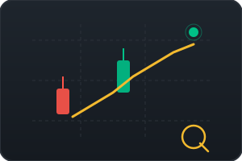

# Live Market Screener

Real-time crypto market screener pulling live ticker data directly from **Delta Exchange** via WebSocket. Track 120+ trading pairs with live prices and 24h volatility.

**Live Demo:** [https://crypto-stock-scanner.vercel.app/](https://crypto-stock-scanner.vercel.app/)

## Features

- **120+ Crypto Pairs** - BTC, ETH, SOL, DOGE, and many more
- **Real-Time WebSocket Data** - Low-latency streaming from Delta Exchange public API
- **Live Price Updates** - Flash animations on price changes with directional colors
- **24h Volatility** - See percentage change at a glance (green / red)
- **Smart Search** - Filter pairs instantly by typing symbol names
- **Top Gainers & Losers** - Quick sort by 24h performance
- **Dark Theme UI** - Trading-grade dark interface with sticky headers and custom scrollbar
- **Affiliate Integration** - One-click "Trade" link to Delta Exchange

## How It Works

1. On load, the screener subscribes to the `ticker` channel on the Delta Exchange public WebSocket endpoint.
2. Price ticks are received in real-time and updated directly in the DOM using a cached element system for max performance.
3. Positive changes are highlighted in green; negative changes in red.
4. The live status indicator pulses while the connection is active.

## Tech Stack

- **Frontend:** Vanilla HTML, CSS, JavaScript (no frameworks)
- **Data Source:** [Delta Exchange](https://www.delta.exchange) public WebSocket API
- **Deployment:** Vercel

## Files

- `index.html` - Complete single-file application (HTML + CSS + JS)

## Screenshot

## License

Open source and free to use.
